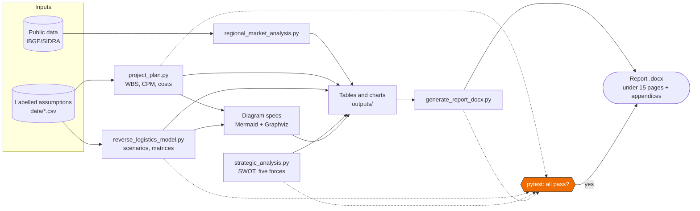
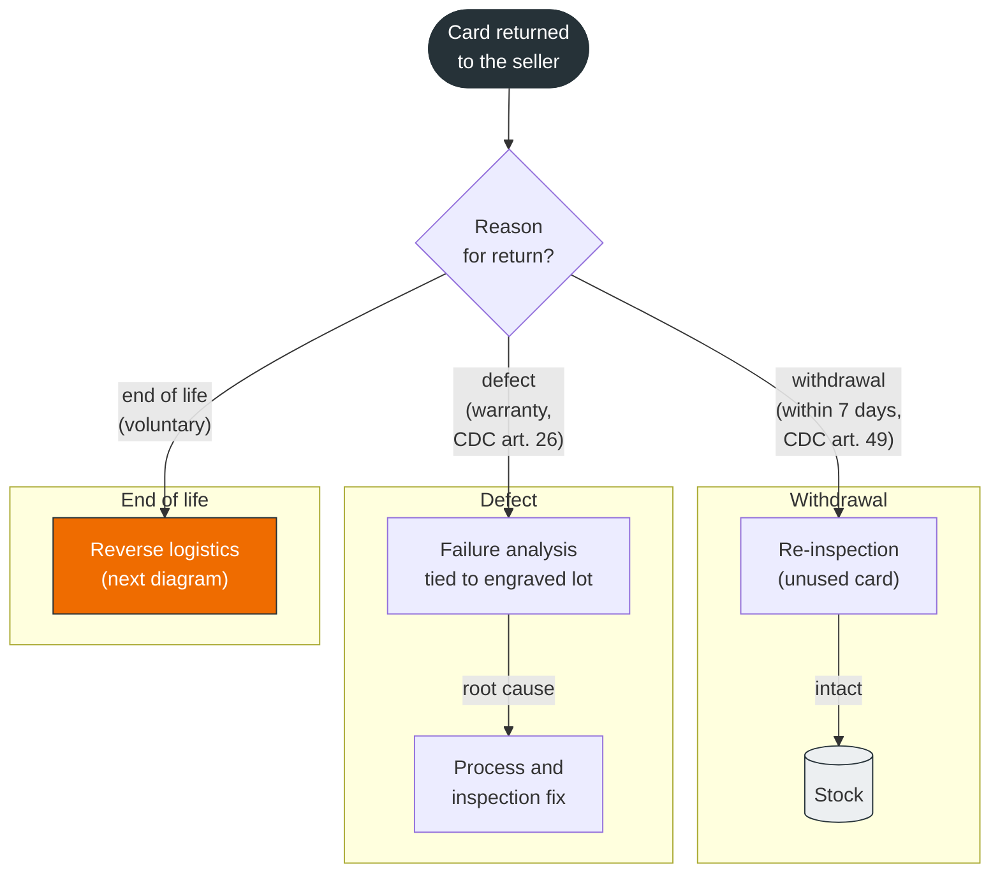
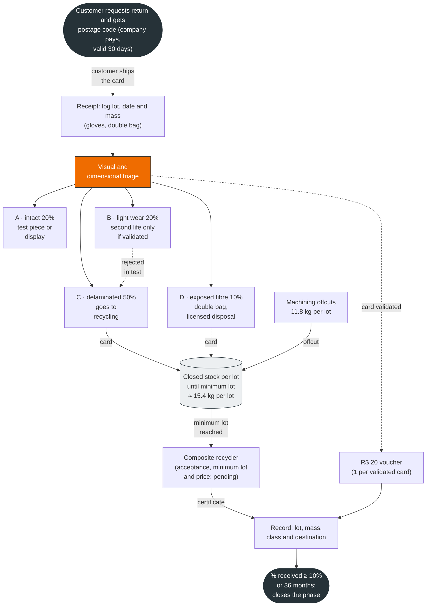
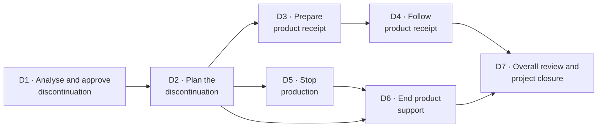

<div align="center">
  
  <h1>Carbon Fiber EDC Multitool</h1>
  <p>Evidence-led product development for everyday carry and urban cycling.</p>
</div>

<div align="center">

[](https://github.com/LucasTramonte/carbon-fiber-edc-multitool/actions/workflows/ci.yml)
[](https://github.com/LucasTramonte/carbon-fiber-edc-multitool/actions/workflows/codeql.yml)

</div>

Reproducible product-development study for a compact carbon-fiber card
multitool intended for everyday carry (EDC) and urban cycling.

The repository is organized as a small research and analysis project. It
separates public source data, executable code, tests, and generated outputs so
that each result can be traced to its inputs and reproduced locally.

## Project scope

The current scope covers:

- exploratory regional market analysis;
- public IBGE/SIDRA data collection and transformation;
- explicit planning assumptions for cost, schedule, and break-even analysis;
- a manual competitor-observation validator for future, sanitized datasets;
- reproducible charts for regional income, financial sensitivity, and project
  scheduling;
- a project plan model (WBS, critical path, cost by resource type, weekly
  baseline) in the format of the course examples;
- an end-of-life (reverse logistics) planning model with labelled assumptions,
  decision matrices, and scenario tables;
- a strategic environment analysis (SWOT matrix and Porter's five forces) kept
  as data, so the report text, table and figures come from one source;
- a market and technology survey organized by the course typology of sources:
  public statistics (IBGE, Cetic.br), the national cyclist profile survey,
  patents and competing products, with ROI, NPV and IRR goals by sales volume and a
  sample-size and price-research design for the primary research still to do;
- the complete Portuguese course report as DOCX (body under 15 pages plus
  appendices), generated from those models.

This is not a sales forecast, a safety certification, a manufacturing drawing,
or evidence of product-market fit. Technical specifications and commercial
assumptions require prototype testing, quotations, and primary research.

## Workflow at a glance

Two workflows matter here: how the repository turns labelled inputs into the
report, and what happens to a card the customer sends back. The report itself
is written in Portuguese for the course; everything in this README and in
`docs/workflows/` is English.

### 1. From inputs to the report



Change one row of a labelled assumptions file and rerun the commands in
[Reproduce the analysis](#reproduce-the-analysis): numbers, tables, charts, and
the document text update together.

### 2. What happens to a returned card

Where can a returned card go? Only the end-of-life branch is reverse logistics.

<!-- workflow:motivo:start -->

<!-- workflow:motivo:end -->

What happens at end of life, and where does the mass end up? Dashed lines are
conditional paths; orange marks the decision point; the cylinder is held stock.
Percentages and kilograms come from the model's reference scenario (assumed
values, not observations).

<!-- workflow:fim_de_vida:start -->

<!-- workflow:fim_de_vida:end -->

How the seven discontinuation activities depend on each other (mirrors the
course's phase dependency diagram; D6 also depends directly on the plan):

<!-- workflow:fase:start -->

<!-- workflow:fase:end -->

The diagrams are code, not drawings: one flow specification in
[`src/flow_specs.py`](src/flow_specs.py) (bilingual) is rendered by
[`src/reverse_flow_diagram.py`](src/reverse_flow_diagram.py) into the Mermaid
blocks above (GitHub renders them natively), the English Graphviz sources in
[`docs/workflows/`](docs/workflows/), and the Portuguese PNGs used in the
report. Do not
edit the blocks by hand; run `python src\reverse_flow_diagram.py`.

## Repository architecture

```text
.
├── assets/brand/               # Public visual identity assets
├── docs/workflows/             # Generated Mermaid (.mmd) and Graphviz (.dot) sources
├── report/                     # Cover data template (the real team file is git-ignored)
├── data/                       # Public inputs and raw API extracts
│   ├── README.md               # Provenance and data contracts
│   ├── ibge_state_*.json      # Raw SIDRA responses
│   └── *.csv                  # Tabular extracts and planning inputs
├── outputs/                    # Generated artifacts only
│   ├── README.md
│   ├── tables/
│   └── visualizations/
├── src/                        # Reusable Python modules and CLI entry points
├── tests/                      # Unit, integration, and adversarial tests
│   └── adversarial/
├── Dockerfile
├── requirements.txt
└── .env.example
```

The product mark is included as a visual identity asset and is displayed at
the top of this document. It is kept separate from analysis outputs and data.

## Engineering automation

The repository includes:

- CI on every push and pull request across supported Python versions;
- CodeQL static analysis for Python;
- dependency review on pull requests;
- Dependabot updates for Python packages and GitHub Actions;
- a pull-request checklist covering provenance, privacy, tests, and outputs;
- `CODEOWNERS` and a security policy for maintainership.

These workflows are intentionally restricted to read-only repository access
unless a security-analysis permission is required by CodeQL.

Academic handouts, copyrighted reference documents, editable reports,
credentials, personal data, and private marketplace exports are intentionally
excluded. The repository is designed to remain publishable without exposing
restricted course material.

## Environment setup

Python 3.10 or newer is recommended.

```powershell
python -m venv .venv
.\.venv\Scripts\Activate.ps1
python -m pip install --upgrade pip
python -m pip install -r requirements.txt
```

The same commands can be run with the Python interpreter configured by the
workspace. The project does not require credentials for the public IBGE
pipeline.

## Reproduce the analysis

Run commands from the repository root:

```powershell
python src\collect_data.py
python src\consolidate_indicators.py
python src\regional_market_analysis.py
```

The first command fetches the 2024 IBGE/SIDRA population and income
indicators, saves the raw JSON responses, and writes CSV extracts. The second
creates regional aggregates. The third writes derived tables to
`outputs/tables/` and PNG visualizations to `outputs/visualizations/`.

The complete report is reproduced with:

```powershell
python src\generate_report_docx.py        # models, diagrams, figures and the report
                                          #   -> outputs\relatorio_cartao_multitool.docx
python src\reverse_flow_diagram.py        # only the workflow diagrams and README blocks
python src\strategic_analysis.py          # only the SWOT and five-forces figures
                                          #   -> outputs\visualizations\fig_swot.png, fig_porter.png
```

The SWOT items, the five-force scores and their justifications live in
`src/strategic_analysis.py`. The report (Section 1.5) reads them from there, and
the tests check the structure (four quadrants, five forces, scores from 1 to
5), the mean used in the text, and the consistency of the cost figures quoted
in the justifications with the project plan.

Rendering the workflow PNG needs [Graphviz](https://graphviz.org/download/)
(`winget install Graphviz.Graphviz`); without it the model falls back to a
simpler matplotlib drawing. The `.docx` output is ignored by git, like other
report files. Copy `report/team.example.json` to `report/team.local.json` and
fill in the team data to personalise the cover; the local file is git-ignored.

The marketplace-related scripts are deliberately not part of the public
repository because access may require OAuth credentials and because raw
marketplace material can contain restricted or identifying information.

## Test-driven quality checks

Run the complete test suite:

```powershell
python -m pytest -q
```

The tests cover:

- valid and invalid price parsing;
- missing-column failures;
- duplicate URL removal;
- negative, non-numeric, and empty prices;
- formula-like spreadsheet text treated as inert data;
- incomplete IBGE inputs;
- regional aggregation invariants;
- generated table and visualization contracts;
- the project plan, reverse-logistics and strategic-analysis models, including
  report structure, numbering, citations and table layout.

The `tests/adversarial/` suite intentionally exercises hostile or malformed
inputs before they reach the analysis outputs. New behavior should be
introduced with a failing test first, followed by the smallest implementation
that makes the test pass, and then a full regression run.

## Data governance

Every quantitative dataset should retain:

1. source institution or endpoint;
2. table, variable, or query identifier;
3. reference period;
4. access date;
5. whether the value is observed, derived, assumed, or hypothetical.

Population, income, advertised listings, sales, purchase intent, and market
segmentation hypotheses are different evidence types. This project does not
use population multiplied by income as a demand estimate. Financial scenarios
use clearly labeled planning assumptions and must not be presented as observed
prices, sales, or market share.

See [`data/README.md`](data/README.md) for the public dataset inventory and
data contracts.

## Security and privacy

Never commit:

- `.env` files, access tokens, refresh tokens, client secrets, or passwords;
- personal information or raw participant responses;
- private marketplace exports or screenshots containing account data;
- course handouts, copyrighted reference files, or unpublished reports.

Use `.env.example` only as a list of variable names. Do not paste secrets into
issues, commits, logs, notebooks, or terminal output. The `.gitignore` file
contains explicit protections for local and restricted materials.

## Container usage

Build and run the public collection pipeline:

```powershell
docker build -t carbon-fiber-edc-multitool .
docker run --rm carbon-fiber-edc-multitool
```

## Team contributions

| Contribution | Where | Author |
| --- | --- | --- |
| SWOT matrix and Porter's five forces (source text and scores) | `src/strategic_analysis.py`, report Section 1.5 | Marco Gabriel Landivar Silva |
| Market analysis, project plan, reverse-logistics model, report generator | `src/`, `data/`, `docs/` | Lucas Tramonte |

The original strategic-analysis document is kept locally as
`assets/SWOT_Porter_cartao_multitool.docx`; like every `.docx`, it is ignored by
git. Its content is versioned here as data and code instead.

## License and attribution

No open-source license is currently granted. Public data remains subject to
the terms of its original providers. Cite IBGE/SIDRA and Cetic.br according to
their official documentation when reusing the datasets or derived results.
